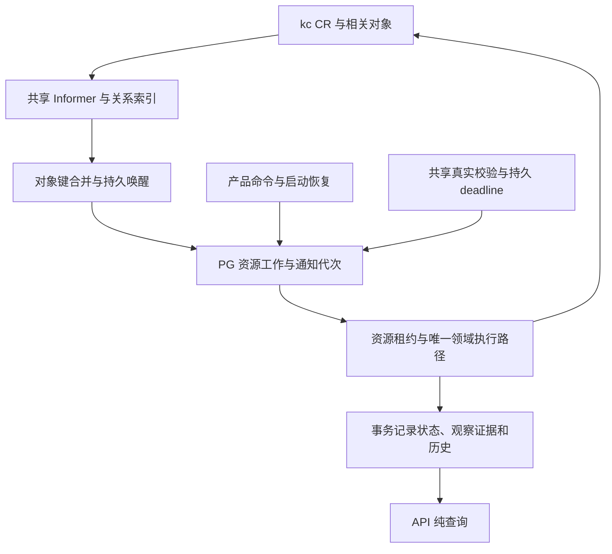

# CR 持续观察与持久执行规格

日期：2026-11-03。版本：2。适用工作包：NET-05A 与网络管理简化。

本文件是 NET-05A 的目标行为，当前是否实现只看[执行状态](../execution/status.md)。[ADR-0004](../adr/0004-observe-cr-with-durable-reconciliation.md)记录选型与范围；[实施方案](../plans/cr-observation.md)规定步骤和退出证据。资源、operation、Attachment、删除及租户规则继续引用[VPC/Subnet 规格](vpc-subnet.md)，本文件只定义观察与调度增量。

## 1. 目标与边界

覆盖 VPC、Subnet 持续状态观察，以及 Attachment 和删除保护所需的 Pod、VNic、VNicIP、EIP 关系。稳定集合在观察范围内共享缓存和索引，消除每个 Attachment 反复扫描全体关系对象的路径；事件加速变化感知，持久工作与真实校验承担恢复。

保持现有 REST/RPC、公开状态枚举、永久幂等、operation 终态、Provider 创建/删除身份、Attachment 提交封闭和无 RLS 租户约束。Network 不取得 Pod/VM、OVN 或其他产品领域的写入权。

2026-11-03 增量覆盖 VM/LB 动作的当前网络核验、Console 观测提示与已有终态记录退休；IAM、KCN 实现及其他产品改造不在范围内。配额及治理结算延期，不新增占位表、假 RPC、通用 outbox 或账本计数。观察器只提供事实，未来配额决定仍须通过资源 owner 与治理 owner 的独立协议。

## 2. 观察与执行路径



观察 adapter 位于 `internal/data`，隐藏 Kubernetes 类型、GVR、索引和连接管理。`internal/biz` 保留状态转换及所需端口；`internal/server` 和 `cmd/ani-resource-service` 管理启动、停止、有界并发、健康及遥测。沿用固定版本 client-go 的 Reflector/ListWatch 恢复能力，不手写断线重列举协议。

Watch handler 只提取对象键、旧/新关系提示并进入有界合并队列，不直接执行 Provider 写入、状态转换或慢 PG/RPC。队列桥接到 PG 调度；溢出或持久化失败须记录范围失效并安排完整清点，进程退出后由启动清点和持久 deadline 补回。内存队列不是唯一恢复依据。

按 cluster、GVR 和明确 namespace/selector 范围复用观察，不能每个产品资源开一个 Watch。VPC/Subnet 通知映射回已有持久 binding；关系通知反向映射 Attachment、Subnet、VPC。索引至少支持稳定 attachment 身份、Pod UID、VNic owner UID、VNicIP 引用和 Subnet 依赖，并保留识别迟到/孤儿对象所需的已知身份。

status-only、deletionTimestamp、归属、标签与引用变化都属于相关变化；generation-only 过滤不适用。处理旧/新关系、同名不同 UID、删除 tombstone 和乱序通知，不能只唤醒新关系一侧。标签只用于候选定位，权威归属仍由 tenant、cluster、绑定及 UID 校验决定。

派生网卡/IP/EIP 可能不带 Network 标签；观察范围必须覆盖完整阻塞关系。selector 外移或缓存缺失均不能证明对象已释放。最小 RBAC 明确 get/list/watch 与现有资源写权限，不增加 Secret 读取或 Pod 写权限。

## 3. 持久唤醒与并发

资源 reconciliation 与 Attachment 调度分别保存独立的 `requested_generation`、`processed_generation`（实现可采用等价命名）。它们是本服务通知代次，不是 Kubernetes resourceVersion、产品 version 或 lease epoch；迁移、默认值和约束必须覆盖已有行与新受理工作。

1. 接受相关通知时，按持久资源身份合并触发并增加待处理代次，不撤销当前有效租约。相同通知的多副本重放不得改变业务结果。
2. Claim 使用数据库时钟和现有资源租约，捕获本次通知代次。产品命令、周期核验、墓碑与 Watch 提示汇入同一执行路径。
3. 外部核验在事务外进行，Finish 继续校验 tenant、版本、lease owner/epoch 与有效期。
4. Finish 只完成已捕获代次；若期间出现新通知，保留下次执行资格，不能无条件用未来时间覆盖新唤醒。禁止借用删除调度的撤销租约行为。
5. 未发送创建、结果未知、owner 封闭查询和重试 deadline 始终有持久恢复入口，不等待下一条 K8s 事件。重复提示不能无限绕过故障退避。

已按既有清理合同确认删除、无活动 operation、无 pending mutation 且保留原 UID 的记录，关闭逐对象周期调度（`next_run_at=infinity`）；已确认 released 且无协议冲突的 Attachment 同样退休。保留 binding、operation、原消费者及关系身份，相关事件可重新唤醒；启动/共享审计发现原管理对象重现时也恢复处理。不能仅凭 Deleted 清空 reason 或宣称物理释放。缺少原 UID 的历史 Deleted 记录保留 `PROVIDER_OWNERSHIP_CONFLICT` 并停放为人工处理异常，不反复扫描全集，不记为清理成功。活动删除、未知发送、迟到关系和未封闭消费者继续原清理协议。

稳定 Available/Attached 在启用共享观察后停止独立的 10 秒任务；已接受 owner 的 open/stopped 快照、无观测错误或协议冲突的 VM Reserved 连接同样使用共享观察，保留预留占用，不当作首次接入重复采集。重新启动后的首次接入、封闭后的最终释放和协议恢复仍执行各自当前证明。共享审计按既有约 30 秒周期唤醒尚存资源，实际 Watch 变化使用原通知代次。共享恢复不伪造对象变化代次，仍尊重有效租约与重试退避。

已 Released 后发现协议冲突的托管连接保留封闭快照和协议围栏，按不短于 stale_after 的持久退避消费共享完整审计，不逐 Claim 要求新全量采集。恢复要求当前 owner 与已接受封闭身份、revision、摘要和 finalization 完全一致，无实际残留或待定候选，且证明覆盖通知代次、晚于持久异常记录；Finish 在锁内重检。首次 Releasing 的完成仍要求 owner 响应之后的独立采集。已 Deleted、无未决组件变更的 LB 也复用有效共享完整审计；活动删除和未知变更保持当前核验。

通知代次完成还要求本次事实确实覆盖其对应变化，不能仅因 Claim 读到了最新代次就将其标记完成。多副本缓存可能不同步：A 已应用新事实后，B 即使合法领取最新 PG version，也不能用自己较旧的缓存覆盖状态。观察结果须携带可核验的来源与覆盖证据；不能证明不旧于 Claim 前已持久应用事实、或不能覆盖本次触发时，直接核验/重新同步并保留待处理资格。此约束适用于普通缓存与审计视图，不能靠租约或 resourceVersion 数值比较代替。

完整候选对象集合的摘要不依赖 List/索引返回顺序。计算前只规范化集合顺序，不修改共享视图或省略对象字段；同名异 UID、resourceVersion、地址及状态变化仍改变摘要，对象内部数组仍保留原有顺序。相同事实复用既有摘要不刷新采集时间，也不放宽通知代次、证据过期和 lease/fence 校验。

采用有界 worker 并发，并对 VPC、Subnet、Attachment、不同租户和父资源提供可验证的执行机会；持续 VPC 积压不能使其他类型饥饿。慢 owner RPC/关系核验不得独占全部执行容量。实现记录实际选择的公平策略、并发上限和请求预算，不宣称数据库 SKIP LOCKED 自动提供公平性。

首个部署允许少量副本各持有共享 informer，业务 worker 仍由同一 Network PG 租约协调。按观察范围组织生命周期与索引，为后续按集群/namespace 分片保留边界；本包不预建多集群调度或分布式观察平台。观察副本数、对象规模和内存必须进入容量记录。

## 4. 事实时效与真实校验

保留默认 60 秒展示阈值。VM/容器 Attachment 与 LB 的 VPC/Subnet 准入定向核验原 Namespace、binding UID、实际 CR 配置/代次/Ready；VM 另外核验原 NAD 和既有 VM 网络策略。旧投影年龄不单独拒绝动作，删除、归属冲突、必要管理步骤未完成或当前核验失败仍拒绝。动作核验不刷新持久投影时间。原有 10 秒逐资源轮询是 NET-05A 前的实现基线；新路径分别管理事件提示、持久重试、owner 查询与真实校验时钟。

稳定集合的真实校验以约 30 秒并带有界抖动作为初始配置候选。最终配置必须在验收负载下满足：

```text
最大校验间隔（含抖动）+ 排队 + 完整采集 + 应用/提交预算 < 60 秒
```

这个数值是待测起点，不能作为已经验证的容量或 SLO。超预算时应真实暴露 stale/积压；需要当前证据的动作以自身定向核验决定是否受理，不能通过读取缓存或修改时间戳维持表面可用。

内部证据区分来源代次、实际采集时间、应用进度与状态变化时间。HasSynced 只说明初次同步；无事件不等于故障；resync 只重放缓存；BOOKMARK 不保证周期。上述信号均不能单独给全部资源续鲜。

真实校验按范围共享完整分页结果，只有采集成功、范围和关系覆盖明确、身份通过核对且已应用到相应资源时才能更新其证据。`observed_at` 对应保守的实际采集时间，不能取慢分页完成或迟到事务提交时间。跨 GVR 没有原子快照，复合结论采用所需证据中最弱的有效时间。

周期 LIST 使用独立审计视图，不直接 Replace 正被 Watch 更新的缓存。审计结论携带采集时来源代次和相关对象通知代次；应用前校验，重连或期间变化使结论失效时重新调度，防止旧快照覆盖已应用的新状态。不能比较不透明 resourceVersion 的数值大小来代替同步边界；不相关对象变化不应导致整个集群的证明永久无法应用。

普通 Egress、LB 与已接入 Attachment 只消费共享审计；缺项、过期、来源失效或通知覆盖不足时返回观测异常，保留最后确认的生命周期、配置结果与时间，不在每个对象中触发全量 LIST/重采循环。VPC/Subnet 可精确 GET 自身；普通观察的 NotFound 不触发全量依赖清点，也不自动重建。

共享快照待发布或待新一轮覆盖是本地观察等待，使用独立错误类型识别，不等同 Provider 请求失败。普通 Available/Degraded 资源无活动 operation、无未决 mutation 时，不为此安装指数失败退避；保留常规持久 deadline，允许下一次成功共享审计唤醒。等待不能续鲜或产生新事实，也不扩大缓存有效期。真实 Provider 错误、活动变更、创建和删除继续原退避、身份与清理证明。

基础对象和关系证据先完整采集，可选 LB 范围使用剩余预算的一部分，失败不丢弃完整基础证据；不完整 LB 索引不能证明缺失或完成清理。可选来源断点只通知、失效对应 LB，基础来源断点和真实队列溢出仍保持完整恢复围栏。所有证据保留原采集起始时间。

失败或依赖门控不清除最后确认的 SNAT applied_enabled；真实成功观察到未知/缺失仍按新事实处理。VPC 暂时读取失败只能保留原 UID、无未决变更、未过期的原就绪证明，不延长时间。父子证据由过期恢复新鲜时通知对应聚合/依赖任务，持续新鲜不产生重复通知循环。

平台默认 VPC 出口遵循同一规则：Available/Degraded 的普通观察等待共享审计，读取失败或查询年龄只标记观察待确认，不制造新的降级或清除最后应用结果。首次创建、未决变更及删除保留当前采集和原身份/解绑证明；没有新事实不能从 Degraded 变成 Available，也不能推进清理完成。

未完成操作、未知发送和退出动作保留其必要的当前核验。关键关系审计失效时可在原调用截止时间内重采，真实 API 错误直接返回；无截止时间最多一次回退。owner 封闭后的采集边界、原 UID、配置版本、覆盖和提交围栏保持。普通 Watch 续接沿用 resourceVersion，不使独立审计失效；真正 LIST/relist 或连接错误仍失效。缓存读取、正常续接或单次精确 GET 都不能为整份审计续鲜。

查询超时、来源不同步或应用滞后记为 `PROVIDER_UNAVAILABLE`，`observation_stale=true`，不推断下层故障。LB 的最后配置状态保持；没有当前流量证明时 data_plane_state 继续 unknown。实际下层 False 条件、配置不符、对象消失或归属冲突仍按真实原因处理。界面必须同时显示最后结果与“待确认”。

复合物理观测分别保留完整 API 采集的起始时间与最旧原始证据时间。并发围栏使用完整采集的起点；资源 `observed_at` 与时效检查继续使用最旧原始证据时间。虚拟交换机设备检查复用调用者的同一审计视图，不再为父级 VLAN/地址池另起独立采集；原始证据不得早于该资源此前已应用的原始证据。

已配置交换机中 Prepared/Applied 且非 Unknown 成员的普通节点检查复用共享节点集合，保留原采集时间；节点相关变化（含新增成员、UID 替换）及来源断点失效该证明，等待共享审计。无关节点探测 ConfigMap 更新不强制全量采集。首次配置、未知变更与删除保留当前采集及 UID/RV 围栏。

节点网卡事实的正常续报须与事实变化区分：同一来源身份、完整网卡内容不变，仅有效采集时间向前推进时，Watch 仍更新缓存，但不使仍新鲜的完整审计失效。旧审计保留原采集时间，不能借续报延长证明寿命；新时间须由后续完整采集读取。节点/ConfigMap 身份、归属、网卡内容或未知字段变化，以及时间回退、未来时间、过期或无效文档，继续触发原有失效与重调度；来源重连的代次边界保持。

Node 的 resourceVersion、managedFields、condition 心跳时间及已知 GPU 心跳/注册/容量字段独立变化，不使网络审计失效；身份、网络归属、Ready 状态、删除和未知字段变化仍触发失效。节点事实读取遇到审计失效时，在原请求截止时间内推进数据库采集边界并重试；无截止时间最多刷新一次，真实读取错误不作失效重试。

虚拟交换机将各成员最近成功核验的真实最旧证据时间保存在既有成员记录中。仅对已有完整、未过期成功证据的 configured 交换机，临时读取失败可保留可用状态并记录失败原因；失败不得刷新证据时间，超出 StaleAfter 或真实归属冲突仍降级。创建、分配和删除继续要求各自的新鲜证据与身份围栏。公网池与 VLAN 将交换机暂时不可用分类为依赖不可用，不冒充所有权冲突；交换机失败日志保留节点、阶段和原始错误。

缓存用于普通观察和关系定位。创建、未知请求、UID 冲突、删除及 released 判定继续要求必要的直接 API/完整关系核验。优化这类核验可以共享覆盖完整的集合证据，但不能把每个 Attachment 的全集群扫描仅改名后保留。

VM Attachment 的 Pod/VNic/VNicIP 关系复用同一共享完整审计，候选与通知映射同时包含 owner snapshot 中的 VM/VMI controller 及当前、历史 launcher 的 UID 和名称。候选只定位证据，VM→VMI→launcher、Namespace/NAD、原 UID、主网络与地址资格仍按原业务规则核验；VM/VMI 精确读取和封闭后的系统 Nic 清理检查保留。VM 的证明摘要同时覆盖共享候选、实际核验的 VM/VMI 关系和 owner snapshot；不能因候选集合没变就忽略 VMI 状态或地址变化，也不能把精确读取的当前时间当作整份审计的新采集时间。

实例 owner 的持久提交封闭来自其协议；K8s Watch 无法替代该查询。释放仍要求封闭及实际工作负载/网卡/IP 清理证据。缓存 NotFound、Delete 通知、TTL 或连接健康都不能单独完成 deleted/released；已记录 UID 的意外消失不触发自动重建。

## 5. 查询、版本与数据库成本

公开 `version` 继续表示现有业务记录的并发版本，保留本包实施前实际持久回写的递增行为及 Attachment `expected_version`、幂等重放顺序，不改成 CR generation、通知代次或只按 state 字符串递增。新增通知/证据控制字段只用于内部恢复与并发。

本包通过相关变化过滤、键合并、共享校验和调度降频减少重复工作。状态/原因没有变化时不追加领域历史或制造虚拟 operation；但真实证据与调度仍有 PG 写入成本，不以“零稳态写入”为验收承诺。进一步拆分公开业务版本与观察证据写入，需单独定义兼容语义后实施，不能藏在本次性能优化中。

Get/List/GetOperation 保持纯读。验证查询无副作用时，先停止相关后台观察、校验和执行，隔离查询产生的调用；另测只暂停状态应用 worker、保留 Watch 健康的场景，确认未应用的观察不能替持久状态续鲜；当前定向核验成功仍可受理，失败则拒绝。

新增租户内持久关系继续显式 tenant 谓词及保持租户归属的复合 FK；观察器系统入口只能将 Provider 提示映射到本服务已登记资源。平台级连接状态不伪造租户。不得修改已经执行的 migration 文件以改变校验和。

## 6. 故障处理与遥测

Watch 连接配置独立于短请求超时；GET/写请求仍有界。启动、403、429、410、断线和重连由标准机制恢复，并暴露来源同步、错误、队列最老年龄及重新清点进度。新观察范围在同步前不能当作空集合；Watch 失效时真实校验仍须有独立恢复入口。

观察源健康、PG 可持久受理、worker 活跃和 API 查询可用分别表达；Provider 失联不必让纯查询全部失效。GET/写/Watch、对象字节数、缓存/索引内存、请求合并、worker 公平性、PG 事务/UPDATE/WAL 与证据年龄都须可测量。资源 ID、租户 ID 不能成为无界 metrics label。

请求计数按 Kubernetes REST 路径中的实际资源位置归类，Namespace 名或对象名不得改变资源类别；ServiceAccount 与 NAD 不计入 Namespace GET。资源类别保持固定集合。VM 启动/重启预检失败记录安全的阶段与原因；网络过期检查记录 VPC/Subnet 状态、观测年龄和有效期阈值，不记录凭据、原始外部错误或整份冻结配置，公开错误合同保持不变。

## 7. 推广规则

兄弟服务可以采用 client-go 或 controller-runtime，并根据持久意图实际位于 PG 还是 CR 设计恢复。controller-runtime 接 PG 时，Reconcile 可唤醒持久任务，或成为接入持久扫描/并发控制的唯一执行适配；不能与另一套 worker 独立执行相同领域行为。

多个服务可观察同一 CR，但各自仅修改自己负责的产品状态、字段与动作。同服务多副本的共享租约或选主与跨服务所有权是不同问题；不同服务各自的 PG lease 不互斥，职责不同的 Manager 不共用选主锁。选主不撤回旧请求，仍须幂等与条件写入。

兄弟服务需要本域 Provider 事实时可以直接观察，需要另一领域产品结论时消费其版本化 API/事件。接纳本模式不自动授权跨仓改造。各服务文档明确观察范围、控制权、持久权威、幂等和恢复，不强制镜像 PG 或安装公共 runtime。

## 8. 验收合同

以下扩展[VPC/Subnet 验收](vpc-subnet.md#9-可观测性与验收)，实现步骤和证据位置由计划规定；当前结果仅记入执行状态。

| ID | 必须证明的结果 |
|---|---|
| V-16 | 初始同步/403/429/410/断线/静默失联/重连、status-only、重复事件、tombstone、同名不同 UID、旧 LIST 与新 Watch 交错均不会虚构 fresh 或完成释放；暂停应用但保留 Watch 时持久投影不续鲜，动作仍需当前原身份/配置核验 |
| V-17 | 真实 PG 覆盖 Claim/Observe/Finish 前中后通知、不丢唤醒、不撤销有效 lease、旧回写拒绝、未创建 CR 的意图重启恢复、PG 中断/内存队列丢失；双副本“新缓存先提交、旧缓存后 Claim”不回退事实或误完成通知；多副本及持续积压下各资源类型/租户仍有执行机会 |
| V-18 | Pod/VNic/VNicIP/EIP 共享索引覆盖旧/新关系、标签丢失和孤儿对象；不再每 Attachment 全集群 LIST；同数据集比较冷启动、稳定态、变化风暴和恢复的 K8s/PG/内存成本，保留版本与幂等兼容证据 |
| V-19 | 在本包精确新源码/镜像上验证真实 kc List/Watch、RBAC、重连与状态传播，并复验 NET-05 普通容器入口、连通/隔离、Attachment 释放和删除保护；旧 NET-05 结果仅作为对照基线 |

正常负载状态传播 p95 ≤2 秒、p99 ≤5 秒作为候选验收目标。实施开始时固定小规模、目标规模及倍增数据集，声明对象数/大小、变化率、副本数、机器与 PG/API 预算，不在看到结果后降低负载来宣称通过。记录达到与未达到的边界，不承诺无限容量。功能正确性、性能目标和真实数据面分开记 `pass / fail / not_verified`；真实 Watch 不代表真实连通已经验证。
