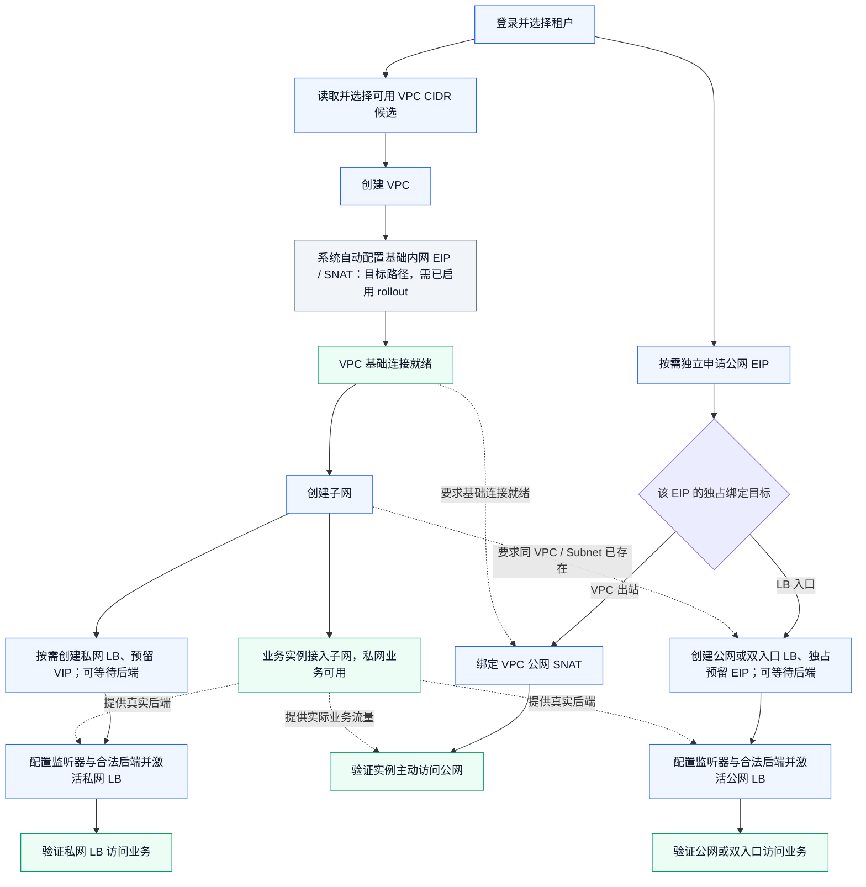
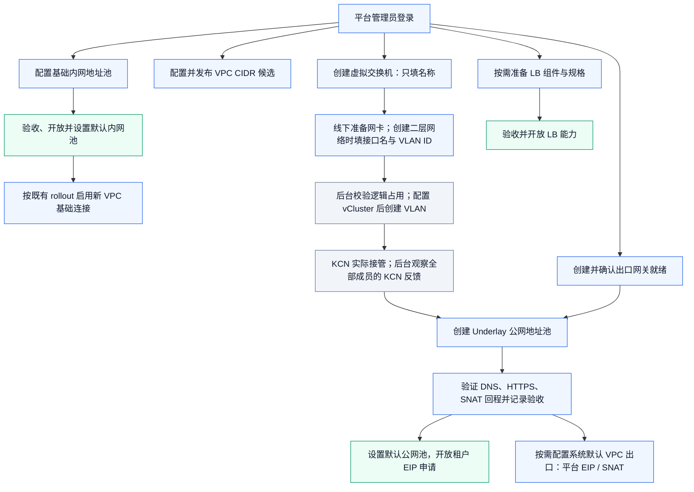

# KCN v0.9 虚拟交换机与二层网络创建流程

日期：2026-10-30（按用户新约定移除 NodeFacts 二次物理审批；其余产品流程沿用既有约束）。本文定义业务规则，实际实施与验收以[执行状态](../execution/status.md)为准；历史来源和受控验收授权保留各自时点，不表示本轮已部署或迁移现有出口。

## 1. 已确认的产品流程与范围

采用 KCN 控制台的对象层次：**管理员在线下准备网卡，先创建虚拟交换机，再创建二层网络时手填接口名。Res 负责逻辑占用与节点组配置，提交 VlanNetwork 后由 KCN 接管。** 不再部署 Resource 宿主网卡采集器或执行第二次物理审批；管理员无需手工打组标签或先调用设备登记接口。

虚拟交换机的用户输入只有 **名称**。当前 Res Network 没有区域/AZ 业务模型，本次不新增区域、可用区、相关字段、表、配置或选择器，也不要求填写简介。系统生成的资源 ID、版本、操作与审计，以及后台真实绑定事实属于必要管理信息，不增加表单输入。

当前部署定位使用 cluster_id 和 namespace_prefix，不把集群解释为区域或可用区。只读核查覆盖 `api/network/v1/`、`internal/biz/network/`、`internal/data/network/`（含 SQL）、`migrations/`、`configs/`、`internal/conf/v1/`；定位见 `internal/data/network/postgres.go`、`configs/config.yaml`、`internal/conf/v1/conf.proto`。

完整主链：**管理员准备目标网卡与上游 VLAN → 创建虚拟交换机（名称） → 创建二层网络（集群、虚拟交换机、手填网卡名、VLAN ID） → 后台固定节点组、预留逻辑占用并创建 VlanNetwork → KCN 实际接管 → 创建公网池与出口网关 → 验收出口 → 开放分配 → EIP/Snat → 真实工作负载出网。** 系统默认 VPC 使用第 7 节的独立平台用例。

当前旧实现的断点仍是接管顺序：Res 等待网卡先被接管，KCN v0.9 在 VlanNetwork 存在后才接管。新流程同时修复这个循环，并把中间设备对象移到后台；减少用户操作不等于跳过权限、持久化、占用或真实就绪门禁。

本版替代本草案上一版“基础设施准备组 → 只读发现 → 独立登记网卡 → 创建 VLAN”的产品流程。逻辑占用、组配置完成、KCN 接管反馈、池就绪和业务出网成功仍分别观察。

## 2. 固定来源与不兼容点

| 来源 | 本文核对的固定版本与边界 |
|---|---|
| Resource 远端 main | `6bff99f1747a495fe4b278844c20ee72b1ce2ffc`，2026-10-21 已确认；旧草案/本地 checkout 基线为 `d32c4f438b43b8cb7534486c73e116e4d26c890a`，不把本地旧文件当最新源码 |
| Governance 远端 main | `323eb749b8a3d607b26687797b372919052895c7`，2026-10-21 已确认；仍固定 Res API 模块 `v0.0.0-20261019174951-733f625995f8`，不等于最新 Res main |
| Governance 先前部署来源 | `codex/gov-model-inference-latest-20261020`，`05bdb9d890b7e89645dd67ed1c697af2ad7c3ed0`；历史来源，不代表本轮确认运行镜像 |
| KCN 缓存源码 | 2026-10-30 本地 HEAD `a1e271c0162fb73ab84e0ca6618e5a7302442bd6`；GitLab 远端最新未确认，也不代表当前运行版本；新 monitor 不设置 VLAN Ready/Healthy |
| KCN 旧运行回执 | v0.9.0，`ca06a4e06c902b9f9cdc6a6a6a1879792e390fd3`；本轮未查询当前 imageID/CRD，不以缓存 HEAD 代替实际部署 |
| installer 远端 main | `78d8418307b6156954feb10aee8d6972d2ff1bbd`，2026-10-21 已确认；components.lock 仍锁 dev/fix2 |
| installer 远端 release | `8df08cd5c13f0ce5156a2df3f1ce0ed8cf56f166`，2026-10-21 已确认；锁定 KCN source `2b9467c`、index digest `494432d2…`、amd64 digest `26470989…` 与 17 CRD；完整物料引用见审查记录 |
| 已有原生出网证据 | [2026-10-20 回执](../../../ani-model-service/docs/deploy/kcn-cluster-public-eip-20261020/README.md)；本文未重新查询集群 |

固定源码及各项修订的直接证据见[关联源码审查记录](../execution/records/kcn-network-flow-review-20261021.md)。跨仓库链接只是时点证据，不成为构建或运行依赖。用户提供的 KCN 截图作为操作层次参考；截图中的区域/AZ 和简介不纳入本方案。

实施前按“installer main 锁定物料 / installer release 锁定物料 / 目标集群实际 imageID、源码 revision 与 CRD”分列版本矩阵，选择与实际运行 profile 对应的适配和完成条件。KCN 远端新鲜度缺口仍须如实记录，不因拉取 installer 新分支就宣称旧集群已升级。

KCN controller/daemon Ready 不能替代 Res 运行前置：目标集群访问身份、Node/ConfigMap 共享读观察、必要 Node patch 权限和仅合并本产品组键的约束/审计必须分别交付。NodeFacts 采集器、事实发布者及旧 kcn-config adoption 写权限不再是前置。installer 的 KCN Node patch 属于 KCN 身份，不自动授予 Res；installer 首装合同也不能作为 10–12 上 Res 功能已交付的证据。NetworkPolicy 仍 unsupported，不增加以 Netpol 放行出口的步骤。

| 环节 | 当前 Res 假设 | KCN v0.9 实际协议与改法 |
|---|---|---|
| 目标节点 | 整个集群同名网卡、无产品交换机 | 由虚拟交换机的节点绑定形成 vCluster 组 |
| 接管触发 | 写 managedDevices 并先等接管 | 先完成组配置，再创建 VlanNetwork 触发实际接管 |
| VLAN 输入 | devName、vlanID | 补齐 vClusterName，继承所选产品交换机 |
| 接管反馈 | 旧 managed_netdevs 注解及 ConfigMap 关联 | 读取对应组设备注解，不声称证明物理或上游链路健康 |
| OVS mapping | net.<dev>:br-<dev> | <vClusterName>.<dev>:br-<dev> |
| VLAN 就绪 | 等 Ready=True | 此版本控制器不发布该条件；使用 Valid/Initialized、完整成员和 KCN 接管反馈 |

managedDevices 仍保留解析，但此版本接管链路不消费它。不能靠增加超时、补旧注解或强制置 available 修复协议差异。

KCN 固定源码定位：`internal/ctrlutils/annotations.go`、`parse.go`、`naming.go`，`api/networking/v1/vlannetwork_types.go`，`internal/controller/handlers/vcluster_handler.go`，`internal/controller/networking/vlannetwork_controller.go`、`subnet_controller.go`，`internal/daemon/networking/vlannetwork_controller.go`。

## 3. 产品对象与 KCN 的对应关系

### 3.1 虚拟交换机由平台管理，用户只填名称

平台保存虚拟交换机的稳定产品 ID 和名称，提供创建、查询、列表、无引用删除；不新增区域/AZ 或描述字段。创建成功表示该配置已持久化，可以创建二层网络，不表示已创建物理桥或出口可达。

名称直接作为 KCN vClusterName：按 Node label-key 名称规则校验，额外禁止点号，平台内活动名称唯一；本期名称不可修改。删除进行中或残留节点绑定尚未完成清理时继续保留名称占用，不能因同名重建把旧组归给新产品 ID。

创建交换机时不要求选择集群或网卡，也不写 Node 标签。首次创建二层网络时确定目标集群并建立实际节点绑定。本期一个虚拟交换机只绑定一个集群；后续二层网络复用该绑定，不支持跨集群复用、原地换集群或用户编辑成员/优先级。集群选择只列出当前 Res 部署已配置可访问的目标；单集群部署只提供该集群，不借本次改造建设跨集群调度系统。

产品交换机有 ID，不代表 KCN 有同名 CR 或 UID。KCN vCluster 仍由 Node 标签派生；平台的 SQL 身份和后端节点绑定事实分别管理，不伪造 group Provider UID。

### 3.2 vcluster.networking.kubercloud.com 的标签协议

同一个完整键放在 Node labels 和 annotations 中时语义不同：

| 所在位置 | 示例 | 语义及写入方 |
|---|---|---|
| Node label | `vcluster.networking.kubercloud.com/ani-public: "100"` | 声明节点属于该组及组内优先级；由 Res 平台绑定操作管理 |
| Node label | `networking.kubercloud.com/allocated: "true"` | KCN 节点已分配状态；Res 不为凑齐成员强制修改 |
| Node annotation | `vcluster.networking.kubercloud.com/ani-public: "ens35"` | KCN 发布该组已就绪的设备列表，多个设备逗号分隔；Res 只读 |
| VlanNetwork spec | `vClusterName: ani-public`、`devName: ens35`、`vlanID: 0` | 指定目标组、接口及 VLAN；VLAN 0 表示不带 tag 的 Underlay |
| OVS mapping | `ani-public.ens35:br-ens35` | 对应组及设备的实际 local network |
| Public Subnet spec | `underlayConfig.vlanNetwork: <VLAN 名>` | 通过 VLAN 关联组，另用 gateway 字段引用 EIPGateway |

```yaml
# 结构示例，不是本轮执行清单。
metadata:
  name: ani-01
  labels:
    vcluster.networking.kubercloud.com/ani-public: "100"  # Res 配置
  annotations:
    vcluster.networking.kubercloud.com/ani-public: "ens35" # KCN 接管后反馈
```

标签不能证明 ens35 已接管，组设备注解是 KCN 配置步骤的反馈，不能证明持续链路健康或上游业务连通。Res 不代写接管成功注解，不直改 OVS。vCluster 是物理网络节点分组，VPC 是工作负载逻辑网络；ani-public 与默认 VPC kcn-cluster 是不同对象。

一个节点可加入多个组；本期后台仍保留 cluster/device 唯一占用保护，不据此允许同一物理口跨交换机重复接管。标签优先级默认 100，只用于 Underlay Subnet 的 GatewayChassis 新候选选择；高值优先、同级随机、目标最多两台，既有有效选择保留。它不是网卡接管顺序或 EIP/Snat nodeName 优先级，也不构成 HA 验收。

Public/Host EIPGateway 没有 vClusterName 字段；Subnet 通过 VLAN 的组为该 Subnet 的 router port 选 chassis。KCN topoVersion 只包含排序节点名，不能替代平台包含 Node UID、allocated 和优先级的成员绑定。

### 3.3 后台如何确定并保存节点范围

首次创建二层网络时，后台从所选目标集群读取**全部 allocated=true 的节点**作为本期成员范围，要求非空；核验 Node 身份、Ready 状态及既有 KCN 分配信息，不采集或审批所填接口。管理员必须预先在完整目标范围准备同名接口；不能根据接口发现结果缩小组，也不能把部分成员接管当完整成功。

把具体成员 Node UID 集合、priority=100、allocated 状态和 membership fingerprint 固定为绑定快照，不只保存一个会动态变化的筛选条件，不再把接口 MAC 纳入新绑定证明。后续二层网络沿用同一完整组，由管理员准备新接口并由 KCN 执行接管。新增 allocated 节点不自动加入平台组，本期不提供成员编辑；已有成员身份、allocated 或外部组标签变化会使绑定退化，要求明确维护方案，不自动扩大或缩小范围。

该选择是本期的产品规则，不是 KCN 只能使用全集群。未来需要节点子集时另行增加明确的成员配置与生命周期，不能引入区域/AZ 代替成员定义，也不能假设同名网卡必然位于同一物理二层域；物理交换机连通和 VLAN 条件仍须现场确认。

首次落地遇到同名外部组标签、原生 VLAN 或其他 owner 的逻辑设备占用时，拒绝自动收养。第 7 节已有网络记录保留其历史时点，不通过创建同名交换机自动纳管。

## 4. 用户操作与后台主流程

以下两图描述目标流程，不表示相关新能力已实现。租户的基础内网、公网 EIP 与 LB 规则承接[统一规格](vpc-connectivity-lb.md)及 [ADR-0005](../adr/0005-separate-vpc-connectivity-and-exclusive-eip-bindings.md)，并按最新 Res 的 CIDR 候选和 LB 延后激活合同更新；管理员公网分支采用本次 Underlay 方案。蓝色表示用户/管理员操作，灰色表示后台自动执行，绿色表示配置就绪或业务验证结果；虚线为额外依赖。

### 4.1 租户网络流程



公网 EIP 申请与 VPC/子网创建可以并行；公网 SNAT 不要求已有子网或工作负载，实际流量验证才需要业务实例。同一个 EIP 在 SNAT/LB 间独占，同一 VPC 可以用不同 EIP 同时配置二者；私网 LB 不消耗公网 EIP。实例由对应业务服务创建，Network 管理其网络接入与引用。

LB 产品创建要求同 VPC/Subnet 存在且未封闭准入；无可运行后端配置时允许先持久化为 waiting_for_backends，并立即保留父引用与 EIP/VIP 占用。工作负载不是创建 LB 的前置，等待状态也不是入口已部署成功。配置合法后端使运行投影激活时，才要求新鲜的 VPC 基础连接、Subnet/EIP 身份、池验证和 LB runtime capability；已接入业务与 LB 配置在激活阶段合流，最终单独验证真实流量。

### 4.2 平台管理员网络流程



默认内网池支撑租户 VPC 的基础连接；默认公网池支撑租户公网 EIP；LB 组件支撑租户 LB。三个能力分别验收，公网或 LB 未就绪不阻止纯私网场景。Overlay 公网池无需上述虚拟交换机/VLAN 路径。系统默认 VPC 出口是第 7.1 节待实现的独立平台用例，不借用租户绑定入口，也不依赖先开放租户分配。

管理员还须预规划并发布 `network.vpc_cidr_presets`，避开现场物理/管理网段和未纳入平台的外部地址范围；配置变更按既有运行流程重启 Resource 生效，空配置对新建 VPC 关闭准入。租户通过 `ListVPCCIDRPresets` 读取当前可选项，首次创建精确匹配候选，并校验新鲜 Kubernetes/KCN 和平台网络事实，不依赖宿主网卡采集；平台池创建也反向拒绝与已受理 VPC 网段重叠。候选发布与内网/公网池准备是并行前置，不新增区域/AZ 或任意跨集群路由。

租户图中的自动基础内网是 `network_connectivity_rollout.new_vpcs_enabled` 已启用时的目标路径。默认 Intranet Pool 合格与打开此持久开关是两个不同动作；开关默认 false，启用后新 VPC 才在单次受理事务固定基础 EIP/Snat 和池版本。存量 VPC 补齐、历史聚合切换沿用既有独立 rollout 流程，不由新虚拟交换机上线自动执行。本轮未确认线上开关状态，也不修改它。

后台配置组标签后仍须满足 KCN 组识别/可恢复前置，再创建 VLAN；未就绪时停在 operation 中显示原因，不进入下游。详细执行及失败边界如下。

### 步骤 1：创建虚拟交换机

管理员只提交名称和幂等键。Res 验证平台权限、合法名称和唯一性，在本地事务写产品记录、成功 operation、幂等快照和审计；返回稳定 ID。操作不依赖 KCN 对象创建，不进入要求 Provider UID 的通用创建成功分支。

### 步骤 2：创建二层网络，一次提交

输入为名称、目标集群、virtual_switch_id、手填的 device_name（如 `bond0`、`eno2`）、vlan_id 和幂等键；现有二层网络简介可保持原有可选语义，不要求增加虚拟交换机简介。用户不依赖接口库存下拉，不传内部 device_id、不单独提交 AdoptNetworkDevice，也不手填节点标签、Node UID 或优先级。

先按原 key 检查幂等重放，再校验所选交换机、集群、第 3.3 节完整节点范围及逻辑设备/VLAN 占用。接口类型、MAC、carrier、管理用途、地址和宿主路由不再由 Resource 重新物理审批；管理员在线下准备，KCN 按其实际合同接管。不得自动删 IP、拆 bond、改默认路由。复用本产品逻辑设备时仍须核实组所有权与全部既有引用。

外部慢查询放在 SQL 写事务外。事务内再次检查幂等键、交换机版本/集群绑定、完整节点成员和资源锁，原子保存首次节点绑定（或核验已有绑定）、内部逻辑设备占用、VLAN、operation、reconcile、历史与受理快照。逻辑设备可供该任务引用，不表示物理已接管；不得先成功提交独立 Adopt 再让前端串第二个接口创建 VLAN。

### 步骤 3：后台落地 vCluster，标签归交换机生命周期

Worker 在事务外逐节点执行：保存原值、Node UID/resourceVersion、产品绑定 ID 与期望值，以条件合并写入对应组标签，保留其他标签。写前再次核验节点身份和当前 owner；只接受本次已记录的续跑结果，不因键值相同就收养外部组。

逐节点进度和写入结果必须持久化。部分成功或响应未知时保留原绑定、占用和 operation，按同一身份继续观察，不全量删标签回滚。后续二层网络复用交换机已有组；不能随某个 VLAN 的失败或删除移除组标签。

**KCN 组识别存在实施前置：** Node 标签写入成功不等于 KCN 控制器缓存已识别该组。固定 v0.9 若先处理 VLAN，可能报 vClusterName 不存在，且未 Initialized 的 VLAN 不保证在后续拓扑变化时重入。因此不能固定 sleep 几秒或只读回 Node 标签就判定此阶段完成。

必须在实施前与 KCN 确认受支持的组识别完成证明，或补齐“组暂缺可重试、组出现后未初始化 VLAN 可恢复”的控制器协议。没有该证明/恢复保证时任务保持明确阻塞，不能隐藏删重建 VLAN、改标签触发或重启 daemon 来模拟产品成功。本文不声称现版已有该能力。

### 步骤 4：创建 VLAN，由 KCN 实际接管

组前置满足后，使用稳定产品派生名创建 Cluster scope VlanNetwork，spec 取交换机绑定的组名、所选 devName 和 vlanID。保留 Provider pending marker、owner、UID/resourceVersion 和完整 spec 核验。

SQL 准入、worker 依赖观察、POST 前最后检查三个 gate 均使用有效交换机绑定和后台逻辑设备占用，不依赖宿主库存，也不在 VLAN 尚不存在时要求接口已接管。创建下游 Pool 仍须等待全部成员的 KCN 接管反馈，不能一起放宽。

KCN 可能先把接口置 UP，再检查 IP，因此接管失败仍可能改变接口 UP 状态；是否恢复须独立维护。VLAN 可用需同时满足：

1. Provider 对象身份和不可变 spec 一致，Valid/Initialized 成立。
2. 组存在且非空，完整 Node UID/priority/allocated 与快照一致，Node 观察新鲜。
3. notReadyNodes 为空；该字段为可能截断的字符串，组缺失时也可能为空，不能单独使用它。
4. 每个成员的组设备注解含所填接口；此项只表示 KCN 已发布配置步骤反馈，不声称 Resource 已观察真实 OVS、link/carrier 或上游连通。

不等待该版本未发布的 VLAN Ready=True。部分成功显示逐节点进度，二层网络仍不可用，公网池不能越过此门禁。

### 步骤 5：公网池、出口验收与租户业务

EIPGateway 可以与二层网络分支并行创建；Public/Host、Cluster scope，不把 localIP 当 EIP。Public Subnet 受理和 POST 前同时要求网关、VLAN 实际接管和新鲜身份合格，保留一 VLAN 一 Subnet、CIDR 不重叠等现有约束。

Subnet 固定 kcn-system，按现有映射生成 Underlay 配置，等待 Valid/Initialized/Ready、underlayState.ready=true、无 notReadyNodes、chassisNode 非空、VLAN 绑定本池。underlayState.ready 镜像 VLAN 摘要，不是独立流量探测。此时仅控制面就绪，新池仍关闭租户分配；对象的状态与代次按第 5.1 节分别观察。

管理员按既有运维流程使用受控、独立记录的验收 EIP/Snat/工作负载，验证外部 DNS、校验证书的 HTTPS、实际 SNAT 地址和回程，记录对象 UID 与清理结果；运维验收不冒充产品申请成功。通过现有 RecordPublicPoolVerification 保存绑定 CNI revision/digest、交换机/成员 fingerprint、设备/VLAN/池/网关拓扑和有效期的真实证据，再开放分配和设置默认池。

租户沿用真实权限与持久用例申请 EIP、绑定自己的 VPC，联合观察 EIP/Snat 地址、独占绑定和启用代次，再用真实工作负载验证业务。切默认池仅影响新申请，不迁移旧 EIP。系统默认 VPC 另见第 7 节；ModelScope pageSize=100 的上游限制属于独立应用问题。

## 5. 接口、状态与数据改动

### 5.1 产品状态

| 对象/阶段 | 成功含义 | 不能推导 |
|---|---|---|
| 虚拟交换机创建 | 名称和产品身份已持久化，可供创建二层网络 | 已有 KCN 组、物理桥或出口 |
| 交换机集群绑定 | 完整成员快照及 owned 标签配置已确认 | 网卡已经接管、KCN 缓存必然就绪 |
| 内部逻辑设备占用 | 节点组/占用有效，可供本后台任务引用 | 物理就绪 |
| 二层网络 available | 同 UID VLAN 及全部目标节点 KCN 接管反馈合格 | 持续物理健康或上游出口可达 |
| Public Pool available | 控制面及依赖合格 | 已验收或允许新分配 |
| EIP/Snat 已应用 | 地址/绑定/VPC/启用代次一致 | 任意工作负载出网成功 |
| LB 产品创建/等待后端 | 产品意图、父引用与 EIP/VIP 独占已持久化，可继续配置 | 已部署监听器或可访问业务 |
| LB 激活配置已应用 | 可运行监听器投影、合法后端与依赖身份已核验 | 数据面业务健康，仍须独立流量证据 |

平台交换机元数据状态与集群绑定进度分别显示；绑定失败要出现在交换机详情和二层网络 operation 中。无 KCN 对象的交换机/设备登记不得伪造 Provider UID，且不派给旧 EnsureEgress(device)。真正外部创建仍按既有 worker fencing 执行。

Provider 观察按对象已发布的状态及代次字段固定，不能统一使用“等待 Ready/Healthy”或凭 phase 字符串宣告业务成功：

| 对象 | 对应固定 KCN profile 的完成依据 |
|---|---|
| VlanNetwork | 同一 UID/不可变 spec、Valid/Initialized、非空完整组、notReadyNodes 和全部节点组设备注解；此版本不发布 Ready/Healthy，不含物理健康证明 |
| Public/Host EIPGateway | 实际 Valid/Initialized/Ready、稳定 UID、localIP 与 router 等依赖；localIP 不作公网地址 |
| Underlay Subnet | 当前对象身份/spec 与已发布代次事实、Valid/Initialized/Ready、underlayState、chassis 和 VLAN 引用；摘要就绪不代表出口流量合格 |
| Snat / EIP | Snat Valid/phase 与真实绑定，EIP boundResource 的类型、名称、VPC、启用状态和所记 ObservedGeneration 对应 Snat 当前 generation；另核 EIP 地址、UID 和独占目标，不等待 Snat Ready/Healthy |

适配仅使用该固定 profile 确实发布的代次字段；缺失、过期、身份/spec 冲突或未知写入保留明确原因与占用，不能补造 condition 或观测证明。

### 5.2 建议 API 合同

以下均未实现；复用既有平台管理员入口、operation 和授权规范。新增公共列表遵守 Gov 当前前端分页合同，不新增租户写物理网络入口。

| 能力 | 用户输入/行为 |
|---|---|
| CreateVirtualSwitch | name、idempotency_key；不接收 region/AZ/description；返回系统 ID、名称与管理状态 |
| Get/List/DeleteVirtualSwitch | 按稳定 ID 操作；新列表使用 page/pageSize，直接返回 items/total，HTTP JSON 的 total 为十进制字符串；只删除无引用且绑定已安全清理的交换机 |
| 网卡输入 | 管理员手填已准备接口名，不依赖接口库存列表作为受理前置 |
| CreateVlanNetwork v2 | 保留名称/既有可选简介/VLAN，增加 cluster_id、virtual_switch_id、device_name；内部登记不成为用户前置操作 |
| Get/List/DeleteVlanNetwork | 保留产品入口，补交换机引用和逐节点进度；删除不删除交换机 |
| 旧独立设备接口 | 发现、登记、查询和退出 RPC/HTTP 全部移除；旧方法调用不再注册，交换机内部逻辑设备继续随二层网络生命周期管理 |

当前 Proto 的 device_id 为第 3 字段，不能把它换名复用为交换机 ID；新增字段或版本化请求，明确旧 device_id 与新参数互斥。旧记录读取及精确幂等重放继续支持；KCN v0.9 下新的无交换机旧式创建若不能满足新前置，应明确拒绝，不猜组或后台收养。

新虚拟交换机列表必须由 Provider 按页直接查询，并在一致快照返回 items/total；不扫描 cursor 全量结果模拟跳页。现有 VLAN/Gateway/Pool 的 limit/cursor 是存量合同，是否迁移必须另列接口范围、兼容窗口和回归条件，本期不顺带改全量旧列表。完整节点成员不是分页资源列表，不能把诊断子集伪装为完整成员证明。

未绑定交换机使用独立 VirtualSwitch DTO 与 validator，允许合法未绑定状态；不能套用当前只接受 device/vlan/egw/pool 且强制 cluster_id/configuration 的 PlatformResource 校验，也不能填假 cluster_id、错误 kind 或 fake Provider UID。新管理员请求沿用 Gov 的 data 包装；产品 ID 校验、路由/方法白名单、独立动作权限、Res 受信 RPC 清单与平台 scope/actor/request ID 接线一并交付，平台调用不夹带租户 UUID。

发布顺序固定为：Res 先完成并正式发布 Provider API/兼容行为 → 固定可追溯模块版本 → Gov 更新 Proto/客户端、DTO/validator、分页和鉴权 → 成对部署验证。Gov 当前固定 `733f625995f8`，不能假定随 Res main 自动更新；不使用 go.work/local replace 或前端两次创建请求绕过正式发布和单次受理边界。

### 5.3 持久化、幂等与所有权

新增平台作用域的交换机元数据（用户业务属性仅 name）、其操作/幂等记录和后台集群/节点绑定事实；不往现有 cluster_id 必填的通用 Provider 资源或操作表塞假集群来保存尚未绑定的交换机。系统 ID、版本、operation 和审计为管理需要；组配置记录完整 Node UID、原标签值、期望值、已应用/未知结果和所有权证据，不能只靠节点标签相同证明归属。

内部设备登记继续保留稳定 device_id、历史外键和成员身份事实，新增交换机/绑定关联、登记版本及退役标记。同一时刻跨所有交换机的 (cluster,device_name) 活动登记仍须唯一；现有永久唯一约束需增量改为“未退役登记唯一”，旧行默认未退役，不能只因换了交换机 ID 就重复接管。VLAN 保存交换机与内部设备引用。保留活跃 (cluster,device_id,vlan_id) 唯一、VLAN/Pool 独占、lease/epoch、BindingID、resource version 和 observed generation 门禁。

同一事务锁定交换机绑定和设备槽位，覆盖并发首次绑定、重复逻辑占用和重复 VLAN 请求；不同集群的并发首次绑定只能有一个成功，失败方不能留下半套占用。成员 fingerprint 固定节点身份、allocated 和优先级，不再纳入宿主网卡库存或 MAC；KCN 正常修改 link/OVS/annotation 不算成员身份漂移。

新交换机操作使用自己的幂等作用域；新二层网络受理使用 fingerprint v2，包含契约版本、目标集群、交换机 ID、网卡、VLAN 和其他实际请求字段。先按旧 kind/key 查询重放，再校验新字段；冻结 v1 编码、原 hash 和 response，不能直接给旧 Go struct 加字段后重算旧 hash。不得更改租户 EIP/Snat 的幂等合同。

增量 migration 需要允许 fingerprint_version=1/2、更新 replay 版本选择、增加交换机及绑定模型、扩展内部设备/VLAN 关联及内部登记退役/活动唯一约束；旧设备登记版本默认 1、未退役，不自动升级或置 available。仅复用旧 schema 的 fingerprint_version=1 CHECK 不足以支持新流程；不修改已执行 migration 字节。

拓扑及验收 fingerprint 纳入交换机 ID、绑定版本、组名、成员/优先级、v0.9 profile 和 mapping；旧证明不适用于新绑定。继承旧 Device 的 ConfigMap UID 不能当作交换机或 vCluster UID。

## 6. 失败恢复与删除

| 情形 | 处理 |
|---|---|
| 逻辑校验失败/首次 SQL 受理失败 | 返回成员、组所有权或占用原因，不写 Node 标签或 KCN 对象，不留下独立已成功设备占用 |
| 部分节点标签写入成功/未知 | 保留交换机绑定、原值及逐节点结果，续跑同一 operation；不删整组回滚单个 VLAN |
| 标签已写但 KCN 未识别 | 等待受支持完成证明/恢复协议，明确阻塞；不能只用固定等待或 Node 读回来判成功 |
| KCN 创建超时/未知结果 | 保留稳定名、pending marker、占用与绑定；单次 NotFound 不足以释放槽位，不换名重建 |
| 部分节点接管成功 | 展示真实进度，阻止二层网络和池可用；不改成功注解、不拆共享桥 |
| 外部组/同名异 UID/owner 或 spec 不符 | 冲突并保留现场，不补 owner 标签自动收养 |
| 成员/allocated/UID/priority 漂移或过期 | 退化并使旧成员证明失效，阻止新准入，不自动加减组成员或删除已有连接 |

固定 KCN 对缺口、已有 IP 等稳定配置错误也可能不重试。实施前同时确认修复物理条件后的安全重驱协议；Res 重试不保证 KCN 重执行。不得隐藏执行删除重建 VLAN、删加组标签或重启 daemon。

退役顺序：关闭新分配 → 显式释放 EIP/Snat/LB 等消费者 → 删除 Pool 并确认最终消失 → 删除无引用二层网络 → 删除无引用 Gateway。二层网络删除只释放其 VLAN 引用，保留虚拟交换机、组标签和其他 VLAN 的设备引用。

同一设备的最后 VLAN 已最终消失、所有结果未知和未完成操作已核清、KCN 最后引用清理已核验后，后台可以在受锁事务内退役内部设备登记并释放活动槽位，保留旧 device_id/历史外键/墓碑。用户无需新增设备删除步骤。此为新内部退役用例，不调用当前拒绝 device 删除的 DeletePlatform；同时停用旧 reconcile 并推进版本/租约 fence，防止迟到 worker 或旧 key 重放重建占用、写标签或新建引用。旧 v1 设备不因新流程上线自动退役或释放 ConfigMap owner。

虚拟交换机 DELETE 在锁定其版本和状态的事务中检查所有尚未最终 deleted 的 VLAN/Pool、未完成 operation 和设备的活跃业务引用，阻止并发创建新引用。有业务依赖或未知写入未核清则返回冲突；仅为清理保留的内部登记和历史墓碑不构成永久阻塞。无业务依赖后先进入 deleting、禁止新准入，再异步清理它自己拥有的组标签，逐节点以 UID/resourceVersion 和期望值条件合并删除，保留其他组标签。

确认自有标签、VLAN 引用及 KCN 发布的组设备反馈已完成逻辑清理后，在最终事务中退役尚未退役的内部登记、完成绑定清理、标记交换机 deleted 并释放名称，同时保留历史。这不声明宿主 bridge/port 已拆。内部登记可在最后 VLAN 清理后提前退役，也可随交换机最终清理退役，不要求双方相互等待。未绑定过的交换机只需本地事务删除及留墓碑。

移除组标签可能清理该组所有设备映射，所以不能作为单 VLAN 的回滚步骤。固定 KCN 的 deleteBridge 是跳过执行，不能把最后引用消失或组设备注解移除当作共享桥已拆；本次不扩展拆桥实现。Res 不执行 del-br，不保证自动恢复历史 IP、路由、UP 或持久网络配置。异步 DELETE 被接受不等于消失，finalizer 未完成不释放占用，不强制去 finalizer 或直接改库跳过状态机。

## 7. 系统默认 VPC 与现有原生资源

### 7.1 kcn-cluster 采用独立平台用例

现有 BindVPCSnat 锁定真实租户 VPC/EIP，检查 tenant、namespace 和 Provider UID。系统 kcn-system/kcn-cluster 不是该租户 VPC，不能伪造租户行或跳过持久化复用该入口。

在本方案的执行 Goal 中独立实现平台集群公网出口：平台授权 → 固定 cluster UID 与允许操作的默认 VPC name/namespace/UID → 引用合格池 → 持久预留平台 EIP 和默认 VPC 公网绑定 → 同 namespace 创建 EIP/Snat → 联合观察 → 系统工作负载 DNS/HTTPS 验证。资源、operation、幂等和独占均为平台作用域，不复用租户记录。

平台基础设施验收与租户 allocation_enabled 开关分别管理，不能为初始化系统出口先开放未验收租户分配。API、数据、权限、独占绑定和退役协议均纳入该 Goal 的实现与真实验收；本轮文档交付不声称已有此能力。

### 7.2 已有原生出口默认保留

2026-10-20 原生流程恢复出口的时点记录如下，不代表当前集群仍有全部对象。用户于 2026-10-30 说明 10～12 上旧版独立网卡登记已清理，本次不再次清理或把它作为移除 NodeFacts 的前置。其他原生网络仍按现有授权边界保护；历史受控拆建恢复范围见[可执行 Goal](../plans/kcn-network-platform-goal-20261021.md)。

| 记录 | 已有身份/含义 |
|---|---|
| 节点组 | ani-public，ani-01/02/03，priority=100 |
| VLAN | cluster-public-ens35-20261020，ens35/VLAN 0 |
| Gateway | cluster-public-egress-20261020 |
| Public Subnet | kcn-system/cluster-public-102-20261020 |
| EIP/Snat | kcn-system/cluster-public-egress-20261020，EIP 172.16.102.192，目标 kcn-cluster |
| 旧平台 Device | device_94d6ebc1e5bb466d9effad72e9fb055d，当时 provisioning/PROVIDER_UNAVAILABLE，保留 ConfigMap/adoption 历史 |
| 旧平台 Gateway | egw_d6d865fccf9946bb90a8a171975be566，当时 available、未被上述原生池使用 |

新建同名产品交换机不能收养上述组或网络。平台显示外部管理并拒绝重叠占用，不能把 ens35 已就绪事实直接写回旧 Device 成功，也不自动合并两个 Gateway。

其他环境若仍有历史 Device，占用和未知写入须按原身份核清，不能因删除原生公网 CR 就推定旧记录已释放，也不能重新启用旧失败 worker。本次不新增旧 adoption 写入或退役流程；不得 raw SQL 删行、直接改 available、盲清标记或以新产品收养原生组。

用户已授权：未来执行上述 Goal 时，如完成公网创建验收确需占用现有公网网段，可以按受控步骤暂时拆除既有公网网络，沿用 ens35、`172.16.102.0/24`、上游网关 `172.16.102.1`、EIP 范围 `172.16.102.192–207` 进行真实创建测试，测试后恢复既有出口。执行前必须固定实际集群身份、完整对象/引用/地址与恢复快照，封闭并发并按 Goal 的依赖顺序拆建，记录中断与每个未知结果；不能把该授权用于自动纳管、任意删除其他网络、消除未核清占用或伪造 KCN 恢复成功。重建可能改变 Provider UID，须记录新旧身份并验证恢复后的地址、绑定与真实 DNS/HTTPS 出口，不能声称删除重建后仍保留原 UID。

只读借用或完整移交仍须独立方案。只读登记本身不获得修改/删除权；完整移交需要 owner 确认、冻结并发、逐对象所有权 CAS、数据回填、未知结果核查、验收与回退。恢复旧产品记录保留产品 ID 和操作历史，先核查 pending marker 与真实引用，不直接清库或删除重建；受控公网验收不自动移交这些历史产品记录。

## 8. 实施落点与交付顺序

| 改动 | 主要落点 |
|---|---|
| 虚拟交换机用例与 API | api/network/v1/egress.proto、internal/biz/network、internal/service/network/egress.go 与 Gov 对应接线 |
| 新列表与未绑定 DTO | Res 原生 page/pageSize + items/total；Gov 独立 VirtualSwitch validator/data 包装/权限白名单；保留旧 cursor 接口迁移边界 |
| 交换机名称及后台节点绑定 | 新增持久模型/增量 migration、internal/data/network/platform.go 与 internal/data/network/queries/platform.sql |
| 二层网络单次受理与设备登记 | platform.go、设备/交换机引用、事务和幂等版本 |
| 条件合并组标签与进度 | KCN adapter、持久 worker、Kubernetes Node 观察；Node patch 权限与应用中仅合并本产品组键的约束 |
| 三处 gate、VLAN 渲染和按对象观察 | platform.go、kc_egress.go、交换机适配；VLAN/Gateway/Subnet/Snat/EIP 分别使用真实状态与代次，无宿主物理审批 |
| 组识别与稳定错误可恢复 | 与 KCN 确认的受支持协议/必要控制器修复，不能由 sleep 或假注解替代 |
| 发布与运行前置 | Res API 正式发布后 Gov 固定依赖；installer main/release/目标部署矩阵、Res Node 读观察/组 patch 与受控部署验证 |

按业务纵向顺序实施：

1. **管理员准备接口 → 平台创建虚拟交换机 → 一次提交二层网络 → 后台组绑定/逻辑占用 → KCN 接管。** 同批接通必要合同、事务、节点标签所有权、三个 gate 和按对象观察；保留实际 CNI profile、组权限和既有组识别/重入边界，不新增宿主物理审批。确需复用 working ens35 时只按已授权维护范围操作，不能当空闲口直接重建。
2. **公网池 → 基础验收 → 租户 EIP/Snat 与 LB 激活。** 复用现有管理和租户持久用例，验证新拓扑证明与真实流量；管理员 CIDR 候选发布和新 VPC 基础连接 rollout 是租户目标路径的前置。LB 先创建/预留、再配置后端激活分别验收，不新增业务实例创建前置。
3. **平台默认 VPC 出口。** 纳入本次执行 Goal，完成第 7.1 节独立用例及真实验收后才能报告系统出口完整平台化。
4. **已有资源移交。** 另按明确批准的迁移方案处理线上原生出口和旧平台记录。

代码实现/重验证按既有远程执行约定；写入前只读核对 10–12 身份。本次没有应用代码、migration、生成、构建、测试或部署执行。

## 9. 验收条件

| 场景 | 必须证明 |
|---|---|
| 名称即全部用户输入 | 虚拟交换机创建只需 name/幂等键，无区域/AZ/简介；系统 ID/审计正常持久化，无 KCN CR/UID 伪造 |
| 新 API 与发布 | 新交换机列表 page/pageSize + items/total 支持直接跳页；未绑定 DTO 不要求假集群/Provider UID；旧 cursor 范围不擅自迁移；Res API 正式发布后 Gov 固定依赖并验证权限 |
| 两步操作闭环 | 用户先创建交换机，再一次提交二层网络；不要求额外 Adopt 或手工组标签；返回真实逐节点进度 |
| 首次绑定和并发 | 目标集群受支持，完整 allocated 成员冻结；不同集群竞争同交换机只有一个成功，无半套设备/VLAN 受理 |
| 手工接口与逻辑校验 | `bond0`/`eno2` 等合法名称不依赖库存选项或物理类型审批；管理员负责准备，Res 保护完整成员、组 owner 和设备/VLAN 占用，不修改其他接口 |
| 组标签协议与恢复 | label 声明、annotation 反馈分离；外部同名组不收养；标签持久化不等于控制器已识别；验证明确可恢复协议 |
| KCN 接管反馈 | 无 VLAN Ready 条件仍能观察完整组反馈；空 notReadyNodes 加缺组、缺少任一成员注解均不能判可用，不宣称持续物理健康 |
| 版本与观察前置 | 分列 installer main/release 和实际 CNI imageID/CRD；Res Node/ConfigMap 共享读观察与 Node patch 就绪，无 collector/adoption 专属写授权；Gateway/Subnet/Snat/EIP 按真实状态、代次和绑定证明，不复用 VLAN 条件 |
| 幂等与一致性 | 旧 hash/快照原样重放，新参数版本化冲突；内部登记和 VLAN 受理原子；未知结果不重建/换名/提前释放 |
| 成员漂移 | 新 allocated 节点不自动入组；UID/allocated/组标签变化退化，保留现有连接并阻止新准入，不再校验网卡 MAC |
| 生命周期 | 删除单个二层网络保留组；最后引用真正清理后内部登记可退役，活动占用唯一、墓碑不永久卡住交换机删除；只清理本产品标签，保护共享桥与其他组 |
| 实际出口 | 基础验收和产品申请/绑定分别记录真实 DNS、TLS HTTPS、源地址与回程；不以 Bound 或一次 200 代替全链 |
| 租户前置与 LB 两阶段 | 预规划 VPC 候选为空、平台冲突或必要 Kubernetes/KCN 事实过期拒绝首次新建；不等待宿主网卡采集；rollout 启用后自动基础连接；空 LB 创建不依赖业务实例但立即独占入口地址，后端激活再核验依赖与实际流量 |
| 当前线上出口 | 默认保留且不自动纳管；如按已授权 Goal 受控拆建，完整记录原始快照、新旧身份、占用与恢复结果，恢复原参数下的地址/绑定/真实出网，不谎称 Provider UID 不变 |

实现、受控验证和真实环境验收分别记录在[唯一执行状态](../execution/status.md)。本规则修订不构成 KCN 恢复适配、拆桥或原生资源迁移已交付的证据，原生流量成功也不能替代产品主链验收。
